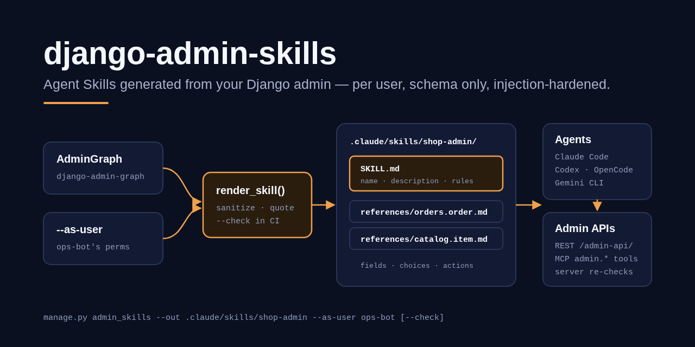
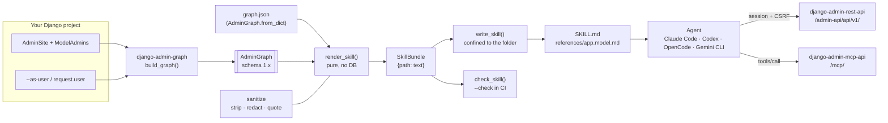

# django-admin-skills

> Generate **Agent Skills** (`SKILL.md` + `references/`) for Claude Code, Codex, OpenCode and Gemini CLI from your Django admin — built from each user's permissions, schema only, prompt-injection hardened.

[](https://github.com/MartinCastroAlvarez/django-admin-skills/actions/workflows/ci.yml)
[](LICENSE)
[](pyproject.toml)
[](https://www.djangoproject.com/)
[](https://agentskills.io/specification)
[](pyproject.toml)



`django-admin-skills` reads your admin through
[`django-admin-graph`](https://github.com/MartinCastroAlvarez/django-admin-graph)
and writes an [Agent Skill](https://agentskills.io/specification): a
`SKILL.md` that tells a coding agent what it may do in your admin and how to
call it — through the
[`django-admin-rest-api`](https://github.com/MartinCastroAlvarez/django-admin-rest-api)
endpoints, the
[`django-admin-mcp-api`](https://github.com/MartinCastroAlvarez/django-admin-mcp-api)
tools, or both — plus one `references/<app>.<model>.md` per model with
fields, choices, relations, filters, search, forms, actions, inlines and
permissions. Runs 100% locally, no paid APIs required.

| Project | Role | PyPI |
| --- | --- | --- |
| [`django-admin-react`](https://github.com/MartinCastroAlvarez/django-admin-react) | React single-page admin frontend | [`django-admin-react`](https://pypi.org/project/django-admin-react/) |
| [`django-admin-rest-api`](https://github.com/MartinCastroAlvarez/django-admin-rest-api) | JSON REST API over `ModelAdmin` | [`django-admin-rest-api`](https://pypi.org/project/django-admin-rest-api/) |
| [`django-admin-mcp-api`](https://github.com/MartinCastroAlvarez/django-admin-mcp-api) | MCP server exposing the same API to LLMs | [`django-admin-mcp-api`](https://pypi.org/project/django-admin-mcp-api/) |
| [`django-admin-graph`](https://github.com/MartinCastroAlvarez/django-admin-graph) | The admin site as a typed, versioned graph | `django-admin-graph` |
| **`django-admin-skills`** *(this repo)* | Agent Skills (`SKILL.md`) generated from the graph | `django-admin-skills` |

---

## Why

An agent that has your admin's API still has to guess what lives behind it:
which models exist, which fields are required, what `status` accepts, which
filter parameter narrows a list, which actions exist, and what this account
may do at all. Hand-written prompts drift from the code and tend to over-promise.
This package writes that knowledge down from the source of truth, every time:

- **One source of truth.** The skill is rendered from a `django-admin-graph`
  graph, which asks the admin itself (`has_*_permission`, `get_actions`,
  `get_fields`, …). This package never introspects the admin on its own.
- **An agent learns only what it may do.** `--as-user ops-bot` builds the
  graph with that user's permissions: models they cannot open are absent and
  never named, and write operations they lack never appear.
- **Schema only.** No rows, no usernames, no hosts (the origin comes from
  `$DJANGO_ADMIN_URL` at run time unless you opt in with `--base-url`).
- **Injection-hardened.** `help_text`, verbose names, choice labels and
  action descriptions are author-controlled; they are stripped of invisible
  characters, secrets, URLs and instruction-like phrases, and rendered as
  quoted data. The test suite proves it against a hostile model.
- **Stays fresh.** Output is deterministic; `--check` fails CI when the
  committed skill no longer matches the admin.

## Quickstart

```bash
pip install "django-admin-skills @ git+https://github.com/MartinCastroAlvarez/django-admin-skills"
# settings.py: INSTALLED_APPS += ["django_admin_graph", "django_admin_skills"]
python manage.py admin_skills --out .claude/skills/shop-admin --as-user ops-bot
python manage.py admin_skills --out .claude/skills/shop-admin --as-user ops-bot --check   # in CI
```

Both packages will be installable from PyPI as `django-admin-skills` once
`django-admin-graph` is published (see the CHANGELOG). The skill works with any
agent that reads Agent Skills: `.claude/skills/` for Claude Code, or your
client's skills folder for Codex, OpenCode or Gemini CLI.

From Python:

```python
from django_admin_skills import generate_skill, write_skill, SkillOptions

bundle = generate_skill(
    name="shop-admin",
    user=User.objects.get(username="ops-bot"),   # or request=request, or neither (whole site)
    app_labels=["orders", "catalog"],
    options=SkillOptions(interfaces=("mcp",), mcp_server="shop"),
)
write_skill(bundle, ".claude/skills/shop-admin")
```

Django-free, from a saved graph (`manage.py admin_graph -o graph.json`):

```python
from django_admin_graph.schema import AdminGraph
from django_admin_skills import render_skill

bundle = render_skill(AdminGraph.from_dict(json.load(open("graph.json"))), name="shop-admin")
bundle.files["SKILL.md"]                       # {path: text} for every generated file
```

See [`examples/skills/library-admin/`](examples/skills/library-admin/) for real
output, checked in CI.

## Architecture



## How it works

1. **Graph.** `generate_skill` calls `django_admin_graph.build_graph(site,
   request)`; with `user=` it wraps the user in an offline request, so the
   graph's own access gate applies (anonymous → `NotAuthenticated`,
   non-staff or inactive → `PermissionDenied`). With neither, the graph is the
   whole site, as a superuser sees it.
2. **Render.** `render_skill` walks the graph: one reference per model with a
   ModelAdmin (inline-only models are documented on their parent), sorted by
   label. Operations are listed only for the permissions the graph grants;
   relations to models outside the graph read "a model not available to this
   skill". Identifiers are validated; anything that does not look like a field,
   model or action name is dropped.
3. **Progressive disclosure.** `SKILL.md` stays short: frontmatter (`name`,
   `description`, `compatibility`, `metadata`), a model table, rules
   (confirm deletes and bulk changes, stop on 403, never store credentials),
   the REST and/or MCP call tables and a change checklist. Detail lives one
   level deep in `references/`, each with a contents list.
4. **Write or check.** `write_skill` writes only inside the skill folder
   (path-traversal and symlink guards), refuses to overwrite a `SKILL.md` it
   did not generate, and removes its own stale references. `check_skill`
   reports `missing` / `stale` / `unexpected` files.

## Configuration

| Setting / option | Default | Meaning |
| --- | --- | --- |
| `DJANGO_ADMIN_SKILLS["INTERFACES"]` / `--interface` | `["rest", "mcp"]` | Which APIs the skill documents. |
| `DJANGO_ADMIN_SKILLS["BASE_URL"]` / `--base-url` | `""` | Bake an origin into the skill. Empty: the agent reads it from the env var below. Credentials, paths and queries are rejected. |
| `DJANGO_ADMIN_SKILLS["BASE_URL_ENV"]` | `"DJANGO_ADMIN_URL"` | Env var the agent reads the origin from. |
| `DJANGO_ADMIN_SKILLS["REST_PREFIX"]` | `"/admin-api/api/v1/"` | Where `django_admin_rest_api.urls` is mounted, plus `api/v1/`. |
| `DJANGO_ADMIN_SKILLS["MCP_PATH"]` | `"/mcp/"` | Where `django_admin_mcp_api.urls` is mounted. |
| `DJANGO_ADMIN_SKILLS["MCP_SERVER"]` | `"django-admin"` | MCP server name in the agent's client, for `server:tool` names. |
| `DJANGO_ADMIN_GRAPH["ADMIN_SITE"]` / `--site` | `django.contrib.admin.site` | The admin site (read by django-admin-graph). |

Command options: `--out DIR` (required), `--name` (default: the folder name;
must follow the Agent Skills naming rules and avoid the reserved words
`claude` / `anthropic`), `--app LABEL` (repeatable), `--per-app` (one skill per
app, `<name>-<app>`, under `--out`), `--as-user USERNAME`, `--graph FILE`,
`--check`.

## Testing

```bash
poetry install
poetry run pytest                         # 120 tests, ~98% branch coverage
poetry run ruff check django_admin_skills tests examples && poetry run ruff format --check django_admin_skills tests examples
poetry run mypy django_admin_skills       # strict
poetry run bandit -c pyproject.toml -q -r django_admin_skills && poetry run pip-audit
```

`tests/test_security.py` builds skills as an anonymous user, a non-staff
user, inactive staff, staff without permissions, view-only staff, an editor
and a superuser, and asserts hidden models are never named, write operations
appear only when granted, no record data or identity leaks, rendering runs
zero queries, and the hostile `Notice` model's text (role markers, fake
frontmatter, bidi characters, a token, an internal URL, an action description
posing as the assistant) is neutralised. `tests/test_spec.py` checks the
output against the Agent Skills rules. CI runs the suite on Python 3.11–3.13 ×
Django 4.2 / 5.0 / 5.1 / 5.2 / 6.0 / 6.1 and re-checks the committed example.

## Part of the series

| Series | Repositories |
| --- | --- |
| Django admin family | [django-admin-react](https://github.com/MartinCastroAlvarez/django-admin-react) · [django-admin-rest-api](https://github.com/MartinCastroAlvarez/django-admin-rest-api) · [django-admin-mcp-api](https://github.com/MartinCastroAlvarez/django-admin-mcp-api) · [django-admin-graph](https://github.com/MartinCastroAlvarez/django-admin-graph) · **django-admin-skills** |
| Agent tooling | [agent-lint](https://github.com/MartinCastroAlvarez/agent-lint) · [repo-graph-mcp](https://github.com/MartinCastroAlvarez/repo-graph-mcp) · [s3-agent-memory](https://github.com/MartinCastroAlvarez/s3-agent-memory) · [pytest-llm-evals](https://github.com/MartinCastroAlvarez/pytest-llm-evals) · [serverless-mcp-aws](https://github.com/MartinCastroAlvarez/serverless-mcp-aws) · [agent-model-router](https://github.com/MartinCastroAlvarez/agent-model-router) |
| Patterns catalog | [agentic-architectures](https://github.com/MartinCastroAlvarez/agentic-architectures) — every agent pattern, linking the LangGraph, ADK, CrewAI and LangChain repos |

## Contributing

See [`CONTRIBUTING.md`](CONTRIBUTING.md), [`ARCHITECTURE.md`](ARCHITECTURE.md),
[`SECURITY.md`](SECURITY.md) and the agent contract in [`CLAUDE.md`](CLAUDE.md).

## License

MIT © 2026 Martín Castro Álvarez. See [LICENSE](LICENSE).
